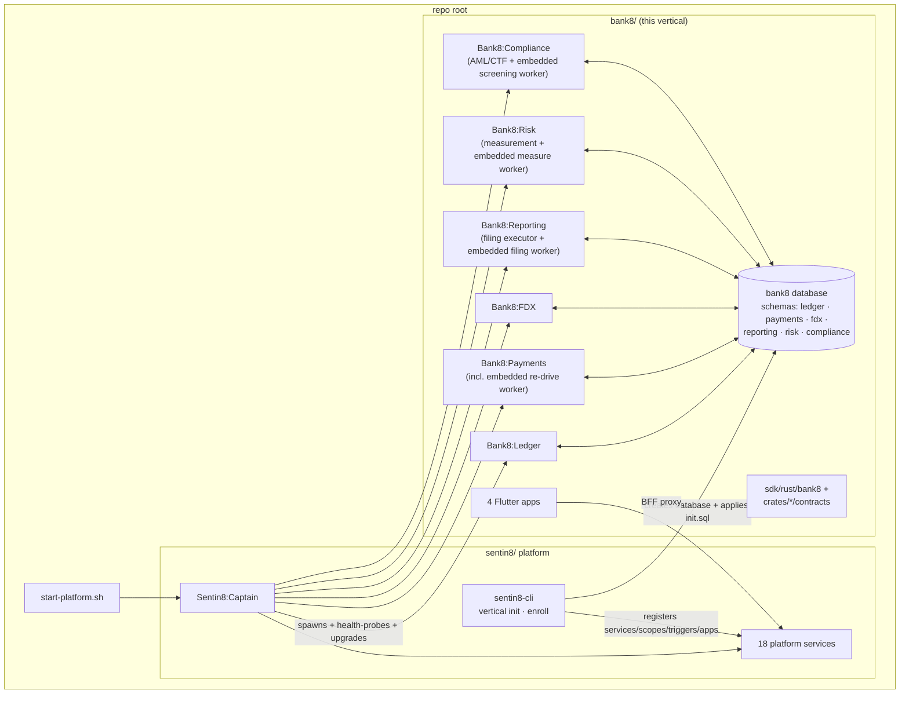
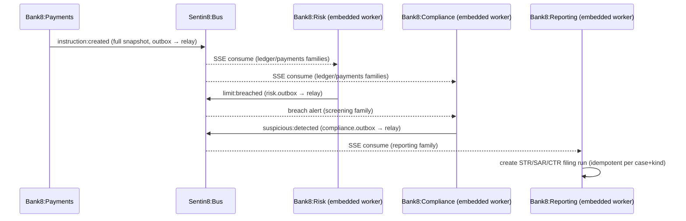
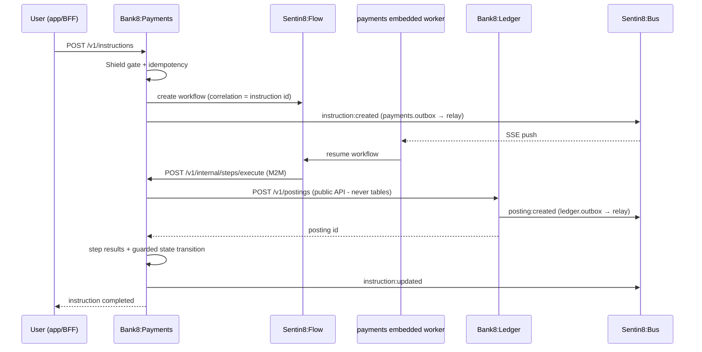
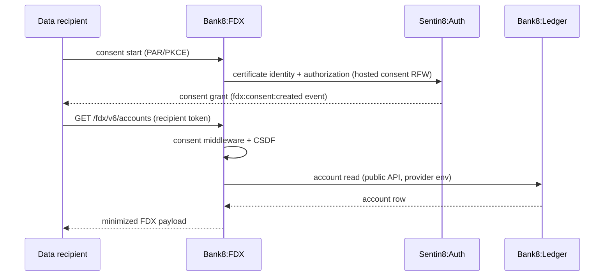
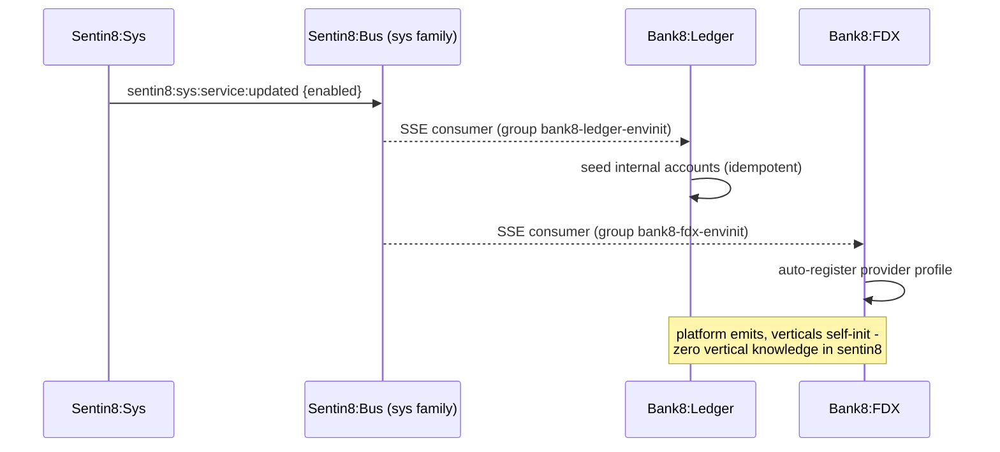
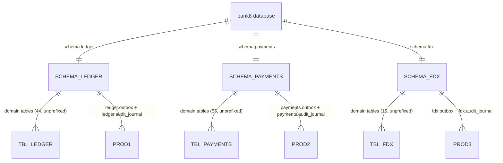
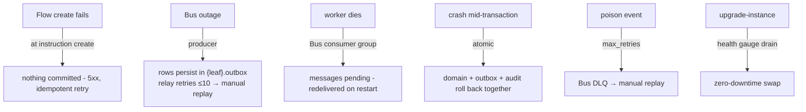
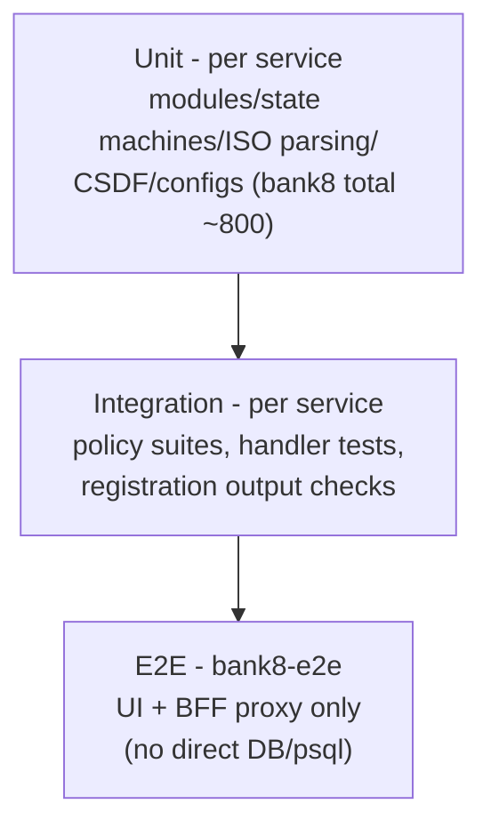

# bank8 - Detailed Design Document (Vertical)

> Secure Post-Quantum-Safe Core Banking, ISO 20022 Payments Secure Post-Quantum-Safe Core Banking & ISO 20022 Payment Platform That Heals and Scales Itself. Open Banking Platform That Heals and Scales Itself.

Per-unit DDDs live beside each service/crate
(`services/{svc}/DESIGN.md`, `crates/*/contracts/README.md`,
`sdk/rust/bank8/README.md`). This document covers what is only visible
at the vertical level: cross-service flows, the vertical database, the
deployment lifecycle, and the vertical registration contract.

## 1. Scope & Context

The vertical owns: the `bank8` PostgreSQL **database** (created by
`sentin8-cli vertical init`), the four services, three contract
crates, the SDK facade, the four apps, and the runtime registrations
(services, admin scopes, event triggers, apps) installed by
`vertical enroll`. It owns no platform infrastructure.

## 2. Runtime Architecture

**Cross-service regulatory flow** (reporting/risk/compliance - the
membus → bus → API order on every hop, principles §4.7; no service
touches another's tables):

**Cross-service money-movement flow** (the vertical's main
end-to-end path - no service touches another's tables):

**Cross-service consent flow (FDX ↔ Ledger)**:

**Env-init (event-driven per-tenant seeding)**:

## 3. Data Model

One database (`bank8`), one schema per service (schema-per-service):

- **Schema-per-service**: each service's schema is its primary domain
  schema - `ledger.accounts`, `payments.instructions`, `fdx.consents`,
  … - and also carries the producer tables (`{leaf}.outbox`,
  `{leaf}.audit_journal`). Table names carry NO `{svc}_` prefix - the
  schema itself namespaces them (a table name must never start with
  its schema name). Queries qualify explicitly (`ledger.accounts`) or
  resolve via the role search_path; no shared vertical-wide schema
  exists.
- **Ownership**: ledger owns schema `ledger`, payments owns schema
  `payments`, fdx owns schema `fdx` - cross-service reads go through
  public APIs, never table grants (a cross-service grant is a defect);
  each role is granted exactly its own schema.
- **Roles**: `bank8_ledger_service`, `bank8_payments_service` (shared
  by payments + worker), `bank8_fdx_service` - NOBYPASSRLS, DSNs
  `postgres://{role}@…/bank8`, search_path `{leaf}, public`
  (the `vertical enroll` default - no vertical-wide schema segment).
- **Producer tables**: `{leaf}.outbox` (NOTIFY `{leaf}_outbox_changed`)
  + `{leaf}.audit_journal` per service - drained by the shell's relay
  (step 8b) and journal pusher (step 8c).
- Per-table catalogs: `services/ledger/DESIGN.md` §3,
  `services/payments/DESIGN.md` §3, `services/fdx/DESIGN.md` §3.

## 4. API Surface

No vertical-level API of its own - every endpoint belongs to a
service (see each DESIGN.md §4). The vertical's external contract is:

| Surface | Path prefix | Consumers |
|---|---|---|
| Ledger API | `/proxy/ledger/v1/*` | ebank, eteller, admin, fdx (internal), payments (posting steps) |
| Payments API | `/proxy/payments/v1/*` (+`v1beta`) | ebank, eteller, admin |
| FDX provider API | `/fdx/v6/*` | external data recipients |
| FDX recipient/consent | `/proxy/fdx/v1/*`, `/v1/recipient/*`, `/v1/auth/consent/*` | efintech, auth-ui consent host |

**Event families** (the vertical's complete Bus surface):

| Family | Service | Stream | Key consumers |
|---|---|---|---|
| `ledger` | ledger | `bus:{env}:ledger` | payments (posting callbacks), AI fraud-scan trigger (registered), e2e |
| `payments` | payments | `bus:{env}:payments` | embedded worker (instruction re-drive) |
| `fdx` | fdx | `bus:{env}:fdx` | notification worker, e2e |
| `sys` (platform) | consumed | `bus:{env}:sys` | ledger/fdx env-init consumers |

**Vertical registration** (`vertical-registry.json` +
`--print-registration`): services ×3 (the re-drive worker is embedded in
payments) with declarative `event_triggers` (payments instruction
completion → ledger posting callback; sys service-updated → env-init),
apps ×4, and per-service `admin_scopes`/`policies`/`m2m_grants`/`pg_roles`/
`sql_migrations` emitted by each service's `--print-registration`.

## 5. Cross-Cutting Concerns

- **Authorization**: every service embeds the Shield engine
  (shell-booted); step 5 is the only gate; scope-mirror sets seed
  enforced at enroll.
- **Tenant isolation**: `env_id` RLS everywhere + explicit
  `WHERE env_id` clauses; holder scoping on customer-held tables.
- **M2M**: certificate identity per workload (`ledger`,
  `payments-worker` + `payments-worker-flow` (the embedded worker's
  consume/re-drive sources), `fdx`, `{leaf}-policy`, `{leaf}-audit`) -
  declared grants in each service's `m2m_grants` section.
- **Audit**: local journal → Sys pusher; domain audit tables per
  service.
- **Idempotency**: posting/instruction `(env_id, idempotency_key)`
  unique; outbox row id = Bus produce key; worker terminal-state
  guards.
- **TLS**: in-process PQ-TLS; `X-Sentin8-*` headers are the only
  tenant source; service ports are auto-assigned (proxy is the single
  ingress).

## 6. Failure Modes & Recovery

Recovery ownership: Bus owns redelivery + DLQ; the shell owns relay
retry budgets; services own only guarded state transitions and
idempotent seeds.

## 7. Concurrency & Performance Model

- Pool cap 3 per service (platform `pg_pool::connect`); the worker
  adds its own capped pool on the same database.
- SSE push (no polling) on every consume loop; NOTIFY + 5s safety poll
  on the relays.
- Captain auto-scale gates per service (busy 60s / idle 300s), rolling
  upgrades with drain.

## 8. Invariants, Insecure-Defaults Rejected, Unsafe Rationale

- No bank8 service ever writes another service's tables - cross-flow
  goes through public APIs or Bus events.
- Each service's role is granted exactly its own schema - one schema
  per service (`ledger`, `payments`, `fdx`); no shared vertical-wide
  schema exists.
- No bank8 table exists outside the `bank8` database; no platform
  table outside `db sentin8` (except the registry reads granted at
  enroll).
- Every domain transaction that emits an event writes the outbox row
  in the same transaction (outbox-first), or the write is
  best-effort by explicit design (non-posting entities).
- `#![forbid(unsafe_code)]` posture in the SDK; no `unsafe` in any
  service.
- Rejected defaults: shared `bank8` superuser DSN for services;
  blanket schema grants; per-handler scope checks.

## 8.1 Fleet-run scope (group operations, STARTSCOPE-1)

The group Makefile's `make start` boots ONLY the platform base
(`sentin8:acme, sentin8:auth, sentin8:proxy, sentin8:bus, sentin8:sys,
sentin8:bff, sentin8:web`) plus this group's services - the
`SENTIN8_SERVICES` boot pin when captain is down, the idempotent
`captain start <types>` API form when it is up. `make stop` stops only
this group's instance rows (the captain and platform stay up). The
full rule (service / group / tree-root scopes and the platform-scoped
dev reset): `design/sentin8-repository-split-design.md` §4.5.2.

## 9. Testing Strategy

- **Unit**: money/path logic is pure and covered in each service
  suite.
- **Integration**: DB-backed suites per service against scratch
  databases; `--print-registration` output shape verified.
- **E2E**: the vertical's flows exercised exactly as a user
  (sign-up → org → env → enable services → app flows); per
  AGENTS.md, e2e never touches the DB directly.
- Not covered here: platform transport layers, Flutter widget tests
  (per-app suites).

## 10. Open Questions

- Live scheme-gateway certification (Visa DPS/MDES/SWIFT) is tenant-driven
  by design - the vertical ships a runbook, not the certification
  (payments DESIGN.md §10).
- Cross-request caches are scoped by caller: the ledger posting money
  path stays transactional; `viewEffective` and the FDX certification
  metrics serve from bounded TTL caches (ledger/fdx DESIGN.md §10).
- The worker's stream env binding - its workload identity defaults to the system
  env while producer events land on per-tenant streams - stays open with
  the platform Bus team (payments DESIGN.md §10 - embedded worker). Its
  in-process fixes (per-event tenant context, correlation-filtered lookup,
  M2M Flow token source) are implemented - BACKLOG WKR-ST1/WKR-TX1.
- FDX mutation handlers' same-transaction tenant-context discipline is
  landed in the core consent/integration paths; the remaining bare-pool
  sibling writes are BACKLOG FDX-RLS1.
- The business-feature catalogs of the historical functional designs inform
  the per-unit `BUSINESS.md`s; implemented-vs-functional deltas are tracked
  as open stories in `BACKLOG.md` (e.g. eTeller page set 2, ETA-5).

---

**Architecture & Design:** bank8 and its underlying concepts were designed by [Hamid Jahanzad](https://www.linkedin.com/in/hamidjahanzad/).
