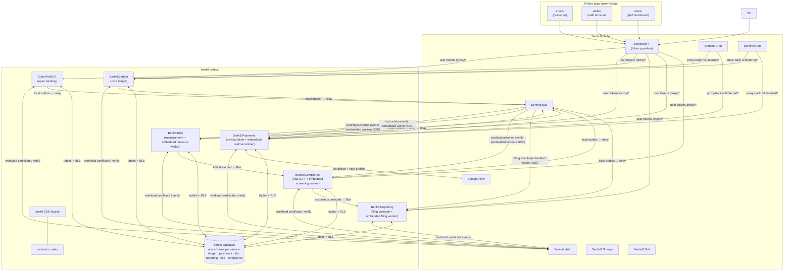

# bank8 - Finance Vertical

> Secure Post-Quantum-Safe Core Banking, ISO 20022 Payments Secure Post-Quantum-Safe Core Banking & ISO 20022 Payment Platform That Heals and Scales Itself. Open Banking Platform That Heals and Scales Itself.

[](LICENSE)
[](https://www.rust-lang.org/)
[](https://bank8.dev/docs/services/listing)
[](https://bank8.dev)

Banking, payments, and open banking: a vertical domain composed on the
Sentin8 platform - a core ledger with double-entry postings, payment
orchestration over ISO 20022 schemes and cards, FDX v6.5 open-banking
data exchange, and the customer/staff Flutter apps that use them.

## 1. Summary

bank8 is the finance vertical of the Sentin8 platform: six Rust
services (ledger, payments, fdx, reporting, risk, compliance) that own
the bank8 PostgreSQL database, four contract crates, a unified Rust SDK
facade,
and four Flutter apps. It contains no platform infrastructure of its
own - identity, bus, storage, scheduling, workflows, and supervision
are consumed from the Sentin8 platform services.

## 2. Motivation

A banking domain needs provable invariants: double-entry balance
atomicity, consent-checked data sharing, idempotent money movement,
and tenant isolation on every row. Building these on shared platform
services (Auth for identity, Bus for events, Flow for orchestration,
Cron for scheduling, Func for hooks) keeps the vertical's code focused
on banking rules instead of re-implementing infrastructure, and
guarantees every service inherits the platform's authorization
pipeline and audit posture.

## 3. Documentation map

| Document | Audience | Content |
|---|---|---|
| `README.md` (this file) | Evaluators / newcomers | What the vertical is, how its units fit together |
| `DESIGN.md` | Maintainers / architects | Vertical-level DDD: cross-service flows, vertical database, deployment lifecycle, registration contract |
| `BUSINESS.md` | Product owners / analysts | The business rollup: capabilities, rules, personas, KPIs, acceptance criteria |
| `services/*/README.md` · `DESIGN.md` · `BUSINESS.md` | Per-service | Overview, wire-level DDD, per-service BRD (ledger · payments · fdx) |
| `apps/*/README.md` · `DESIGN.md` · `BUSINESS.md` | Per-app | Overview, app DDD (bootstrap/proxy/routing), app BRD (ebank · eteller · admin; the recipient app eOpenCA lives in the openfin8 vertical) |
| `crates/*/contracts/README.md`, `sdk/rust/bank8/README.md` | Integrators | Contract crates and the SDK facade |
| `BACKLOG.md` | Planning | The live story list (open only) |
| `vertical-registry.json`, `services/catalog.json` | Tooling | Declarative registration consumed by `sentin8-cli vertical enroll` |

## 4. Architecture & High-Level Design



**Units**:

| Unit | Kind | Role | Docs |
|---|---|---|---|
| `services/ledger` | Rust service | Core ledger: accounts, products, postings, balances, schedules, config library (91 endpoints, 44 tables) | `services/ledger/{README,DESIGN,BUSINESS}.md` |
| `services/payments` | Rust service | Payment orchestration: instructions, scheme flows, cards, mandates, rules + the embedded async re-drive worker (90 endpoints, 55 tables) | `services/payments/{README,DESIGN,BUSINESS}.md` |
| `openfin8:ca` (composed) | Rust service (OpenFin8 vertical) | Canadian open banking (FDX v6.x): consent-checked data sharing, notifications | `../openfin8/openfin8-ca/{README,DESIGN,BUSINESS}.md` |
| `services/reporting` | Rust service | Regulatory reporting: jurisdiction registry, filing calendar, generation/packaging (XBRL/CSV), submission/amendment, AML/CTF filing - the vertical's single filing executor | `services/reporting/{README,DESIGN,BUSINESS}.md` |
| `services/risk` | Rust service | Prudential risk: exposures, capital (Basel), liquidity (LCR/NSFR), IFRS 9 ECL, limit monitoring with breach events, stress scenarios | `services/risk/{README,DESIGN,BUSINESS}.md` |
| `services/compliance` | Rust service | AML/CTF: KYC/CDD, beneficial ownership, PEP, sanctions screening, transaction monitoring, alert/case lifecycle - detection only, filing via Reporting | `services/compliance/{README,DESIGN,BUSINESS}.md` |
| `crates/{ledger,payments,fdx,regulatory}/contracts` | Rust crates | Wire-type DTOs shared by services and SDK | `crates/*/contracts/README.md` |
| `sdk/rust/bank8` | Rust facade | Unified namespace facade: typed clients + contracts | `sdk/rust/bank8/README.md` |
| `apps/{ebank,eteller,admin}` | Flutter apps | Customer and staff experiences | `apps/*/{README,DESIGN,BUSINESS}.md` |
| `bank8-e2e` | Playwright | UI-only end-to-end suite through the BFF proxy | `bank8-e2e/README.md` |
| `bank8-site` | Website | The public website at bank8.dev (Docusaurus on `@sentin8/site-engine`; product/app/SDK pages + harvested reference) |
| `packaging/debian` | Packaging | The `bank8` .deb for install-based distribution | `packaging/README.md` |

## 5. Key Traits and Data Structures

- **Namespace facade** - every crate imports as `bank8::{service}::{…}`
  (`bank8::ledger::contracts::Account`); the vertical consumes the
  platform only through `sentin8::*` (principles §2.1).
- **Double-entry ledger** - posting batches are balance-validated per
  denomination before any write; balances/instructions/transactions +
  audit + outbox commit atomically.
- **Consent authority** - FDX: every provider data call passes the
  consent middleware (valid, unexpired, scope-covered) plus CSDF
  minimization.
- **Event vocabulary** - `bank8:{service}:{resource}:{operation}` over
  the DBX producer path (local `{leaf}.outbox` → shell relay → Bus
  `POST /v1/produce`).
- **Scope vocabulary** - `bank8:{service}:{resource}:{action}`,
  runtime-registered via `vertical enroll` from each service's
  `--print-registration`.

## 6. Rationale, Trade-offs, and Alternatives

- **Vertical owns domain only**: identity/event fabric/storage are
  platform services - the vertical never re-implements them
  (zero compile-time vertical knowledge flows the other way, too:
  principles §4.14).
- **Database-per-vertical, schema-per-service**: each service owns its
  own schema (`ledger`, `payments`, `fdx`) for domain tables and its
  producer tables (outbox/audit journal) in the same schema, so the
  shell relay resolves them via role search_path `{leaf}, public`;
  no shared vertical-wide schema and no blanket cross-service grants.
- **Delegation over embedding**: scheduling → Sentin8:Cron, hooks →
  Sentin8:Func, orchestration → Sentin8:Flow; the services implement
  only proxy-back handlers.
- **Rejected: a monolithic "banking" service** - the
  ledger/payments/fdx split keeps money movement (ledger) separate
  from orchestration (payments) and data sharing (fdx), each with its
  own scopes, tables, and event families.

## 7. Internal Implementation & Invariants

- All tenant tables FORCE-RLS on `env_id`; customer-held tables add
  holder scoping (`sentin8:holder:view-all` is M2M-only).
- Money is `rust_decimal` end-to-end; JSON wire format is a string.
- Terminal states never regress (guarded updates everywhere).
- M2M identity is the workload certificate (auth DESIGN §4.3f) - a
  stolen token is nothing; without the private key the handshake fails.

## 8. Development

```bash
make build          # cargo build --workspace --release
make build-debug    # dev profile for iteration
make build-flutter  # the four Flutter web apps
make test           # rust tests + flutter tests
make lint clippy    # lints
make seed           # register listings + registry
make status         # fleet status (KEY=<ip:port> per service)
make upgrade-instance-debug KEY=<ip:port>   # rolling single-instance upgrade (debug)
make unenroll db-reset enroll   # re-provision the vertical
```

Lifecycle: `make start` boots the platform + captain (which spawns the
enrolled vertical services); `vertical init` creates the `bank8` database
and `vertical enroll` registers services/scopes/triggers/apps (both via
`sentin8-cli`). Packaging into `bank8.deb` is `make deb`. E2E flows live in
`bank8-e2e` and drive only the browser + BFF proxy.

## 9. Unresolved Questions / Future Designs

- Each service's `DESIGN.md` §10 carries the decided directions for its
  open items; the root `BACKLOG.md` is the live story list (open stories
  only: identity-invalidation relay, FDX tenant-context discipline
  completion, worker stream env binding, schema-per-service consolidation
  - §3 of the top-level `DESIGN.md` reflects the landed schema state).
  Items closed as decisions (certification external by design, cache scopes,
  colon-form canonical) live in the design docs, not in a tracker.

---

**Architecture & Design:** bank8 and its underlying concepts were designed by [Hamid Jahanzad](https://www.linkedin.com/in/hamidjahanzad/).
